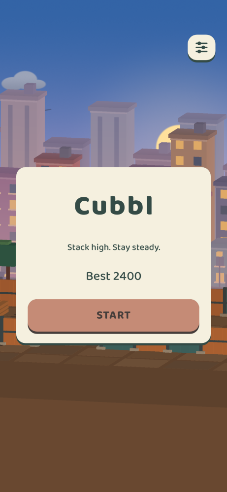
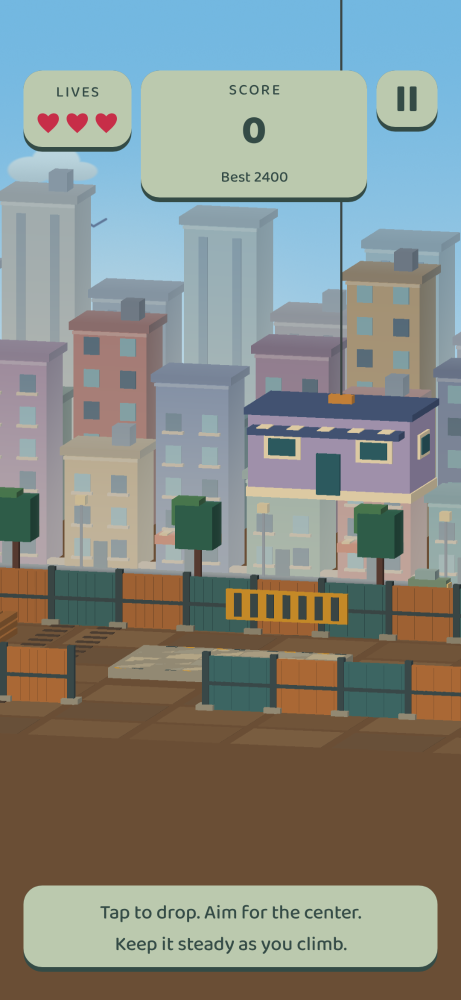
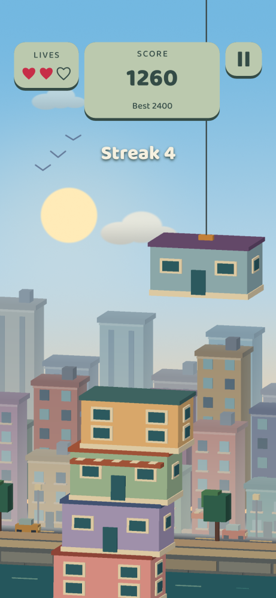
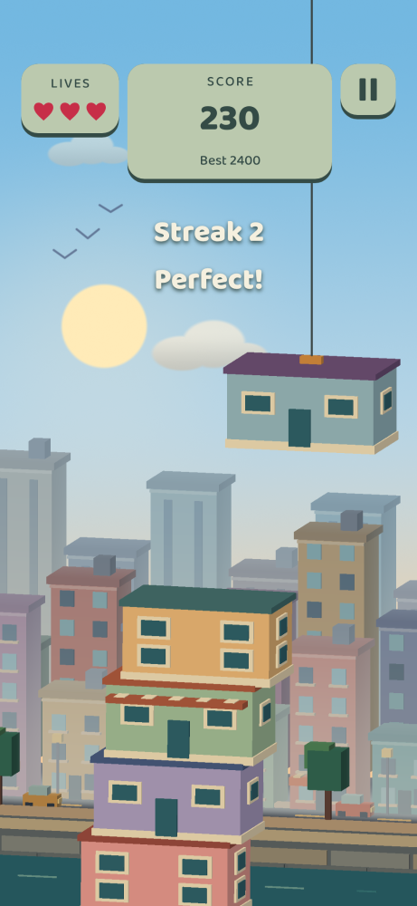
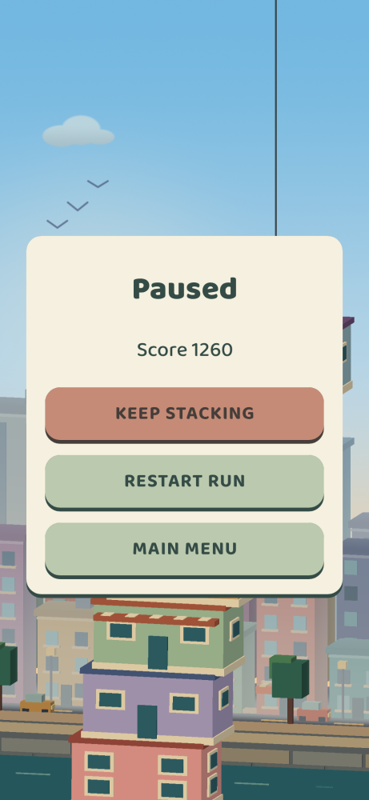
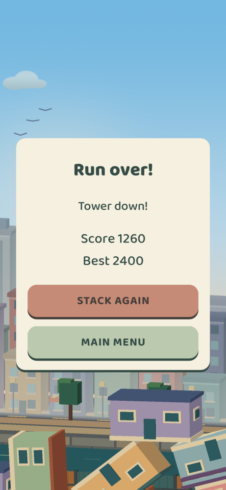

# Cubbl

Offline portrait Android 11+ stacking game. Tap to drop procedural pastel houses; accurate placement earns combo points. Houses keep their offset and can tilt or knock down the tower. Tall, uneven stacks sway more strongly, while the crane accelerates with each accepted floor. Three misses or a tower collapse end the run. Best score and sound/vibration preferences stay on the device.

## Previews

Paparazzi snapshots of the Android UI over recorded GLES gameplay frames.

| Home | Tutorial | Gameplay |
| :---: | :---: | :---: |
|  |  |  |

| Streak | Pause | Game over |
| :---: | :---: | :---: |
|  |  |  |

## Run
Open this project in Android Studio and run `app`, or install the debug APK after `./gradlew :app:assembleDebug`.

## Architecture
See [CAPABILITIES.md](CAPABILITIES.md) and the four root `SPEC-*.md` files. C++ game rules are independent of Android and OpenGL; Android Views, SoundPool and SharedPreferences provide the player-facing adapters. Box2D 3.1.1 is vendored locally with its MIT license; builds do not download physics dependencies.

## Checks
```sh
cmake -S app/src/test/cpp -B /tmp/cubbl-core-tests -DCMAKE_BUILD_TYPE=Debug
cmake --build /tmp/cubbl-core-tests
ctest --test-dir /tmp/cubbl-core-tests --output-on-failure
./gradlew :app:assembleDebug :app:testDebugUnitTest :app:lintDebug
./gradlew :app:connectedDebugAndroidTest
```
For an isolated device, install the app and instrumentation APK and run `adb -s SERIAL shell am instrument -w com.example.cubbl.test/androidx.test.runner.AndroidJUnitRunner`.

See [implementation and verification notes](docs/feature-notes/tower-collapse.md) for actual results, screenshots and hardware checks still requiring a physical device.
